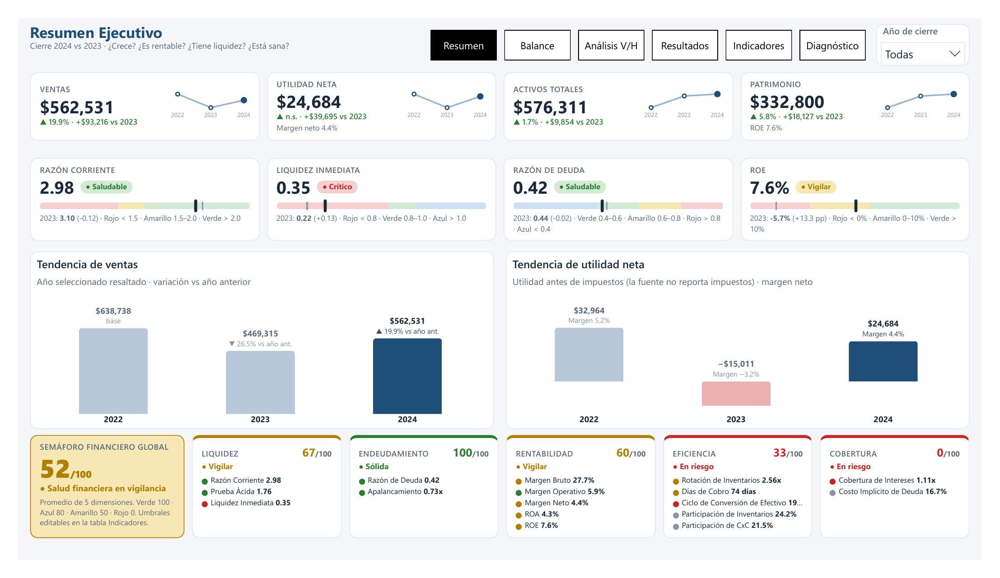
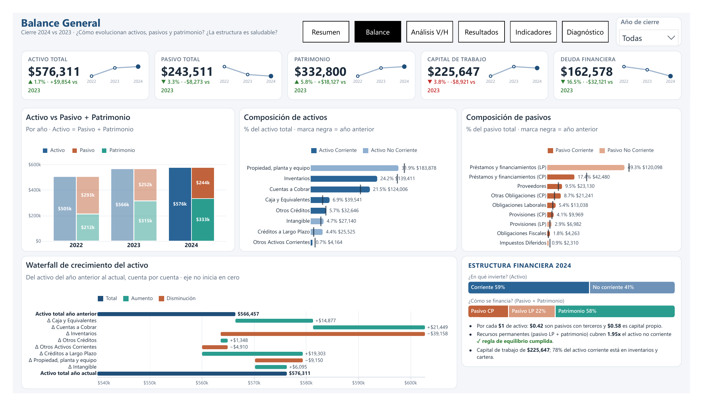
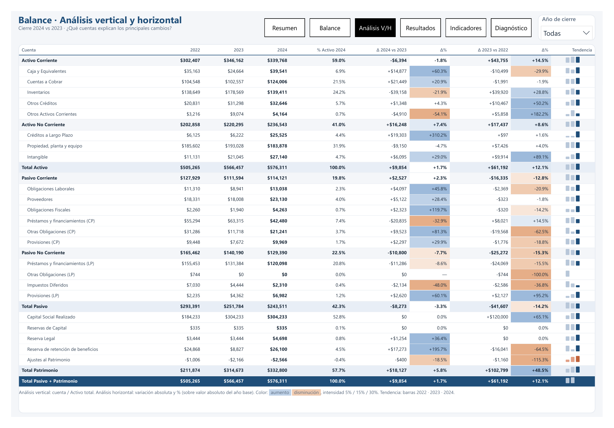
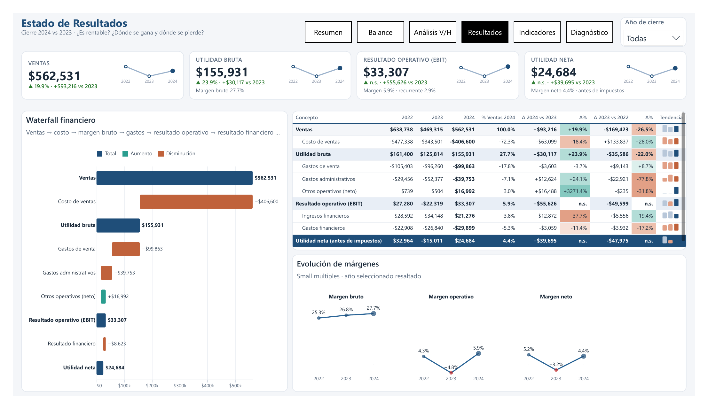
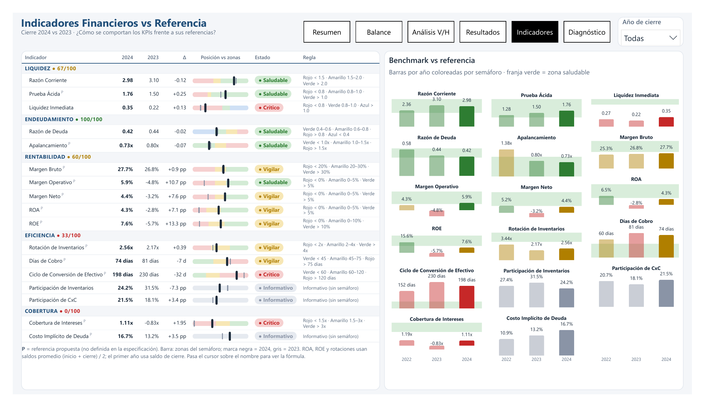
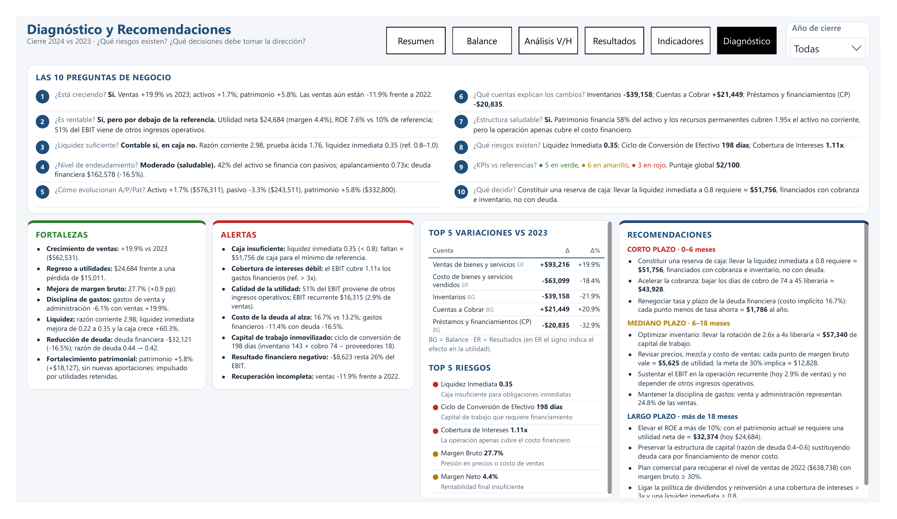
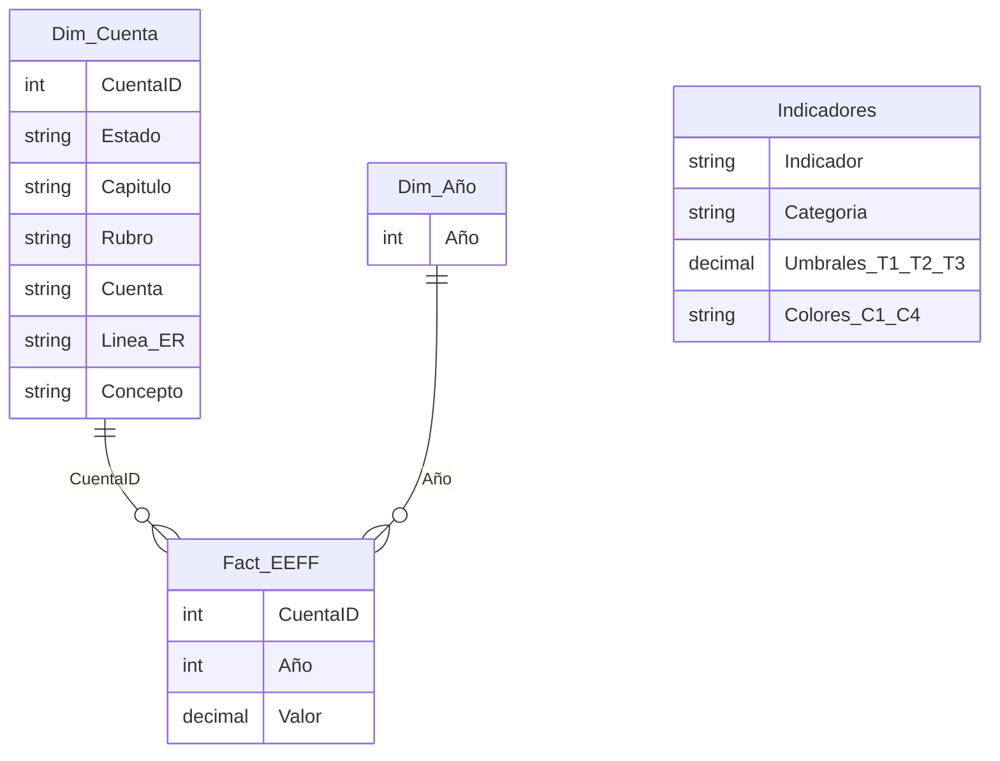

# 📊 Análisis de Estados Financieros · Dashboard Ejecutivo en Power BI

Dashboard financiero para **Dirección General (CEO)** y **Dirección de Finanzas (CFO)**. Analiza la solvencia, la liquidez, la rentabilidad, el endeudamiento, la eficiencia operativa y la estructura patrimonial de una compañía a partir de su **Balance General** y su **Estado de Resultados** (cierres 2022, 2023 y 2024).

El objetivo es ir más allá de mostrar cifras: el dashboard **responde preguntas de negocio, califica cada indicador contra una referencia y genera un diagnóstico con recomendaciones cuantificadas**, que se recalculan para el año seleccionado.


📄 **Reporte completo en PDF:** [`docs/Analisis_Estados_Financieros.pdf`](docs/Analisis_Estados_Financieros.pdf)

---

## 🎯 Preguntas de negocio que responde

| # | Pregunta | Dónde se responde |
|---|----------|-------------------|
| 1 | ¿La empresa está creciendo? | Resumen · Diagnóstico |
| 2 | ¿Es rentable? | Resultados · Indicadores |
| 3 | ¿Tiene liquidez suficiente? | Resumen · Indicadores |
| 4 | ¿Cuál es su nivel de endeudamiento? | Balance · Indicadores |
| 5 | ¿Cómo evolucionan activos, pasivos y patrimonio? | Balance |
| 6 | ¿Qué cuentas explican los principales cambios? | Análisis V/H · Waterfalls |
| 7 | ¿La estructura financiera es saludable? | Balance (estructura financiera) |
| 8 | ¿Qué riesgos financieros existen? | Diagnóstico (Top 5 riesgos) |
| 9 | ¿Cómo se comportan los indicadores frente a sus referencias? | Indicadores (scorecard + benchmark) |
| 10 | ¿Qué decisiones debería tomar la dirección? | Diagnóstico (recomendaciones) |

---

## 🖼️ Vista previa

### 1. Resumen Ejecutivo
KPIs con variación y tendencia, ratios clave con semáforo y bullet chart, tendencias de ventas y de utilidad, y un **semáforo financiero global** (0–100) por dimensión.


### 2. Balance General
Activo vs Pasivo + Patrimonio, composición de activos y pasivos (con la marca del año anterior), **waterfall del crecimiento del activo** y una lectura de la estructura financiera.


### 3. Análisis Vertical y Horizontal
Tres años por cuenta, con % sobre el activo total, variación absoluta y % (con mapa de calor) y una mini tendencia por cuenta.


### 4. Estado de Resultados
**Waterfall financiero** (Ventas → Costo → Utilidad bruta → Gastos → EBIT → Resultado financiero → Utilidad neta), análisis vertical sobre ventas y evolución de márgenes en *small multiples*.


### 5. Indicadores Financieros vs Referencia
Scorecard de 17 KPIs agrupados en 5 dimensiones, con bullet chart contra las zonas del semáforo y un benchmark por año.


### 6. Diagnóstico y Recomendaciones
Storytelling automático: respuestas a las 10 preguntas, fortalezas, alertas, Top 5 variaciones, Top 5 riesgos y recomendaciones de corto, mediano y largo plazo con impacto en pesos.


---

## 🧱 Modelo de datos

Modelo en **esquema estrella**, construido en Power Query a partir de un único Excel con el Balance y el Estado de Resultados por año.



| Tabla | Propósito |
|-------|-----------|
| `Fact_EEFF` | Un valor por cuenta y año: saldos del Balance y flujos del Estado de Resultados. |
| `Dim_Cuenta` | Clasificación financiera: estado, capítulo, rubro, línea del ER y concepto clave (caja, CxC, inventarios, deuda financiera…). |
| `Dim_Año` | Años de cierre; alimenta el segmentador. |
| `Eje_Año` | Eje desconectado: las tendencias muestran todos los años y resaltan el elegido. |
| `Indicadores` | Catálogo de KPIs con **umbrales de semáforo editables en un solo lugar**. |
| `WF_Pasos` | Estructura de las dos cascadas (Resultados y crecimiento del activo). |
| `Medidas` | 222 medidas DAX organizadas en carpetas (Base, Balance, Resultados, Indicadores, Comparativos, Semáforos, Deneb, HTML). |

**Transformaciones clave (Power Query):** se limpian los espacios no separables del origen, se anula la dinamización de los años, se normalizan los rubros, se clasifican las líneas del Estado de Resultados y se parametriza la ruta del archivo.

---

## 📐 Biblioteca de KPIs

| Dimensión | Indicador | Fórmula | Semáforo |
|-----------|-----------|---------|----------|
| Liquidez | Razón Corriente | Activo Corriente / Pasivo Corriente | 🔴 < 1.5 · 🟡 1.5–2.0 · 🟢 > 2.0 |
| Liquidez | Prueba Ácida | (Activo Corriente − Inventarios) / Pasivo Corriente | 🔴 < 0.8 · 🟡 0.8–1.0 · 🟢 > 1.0 * |
| Liquidez | Liquidez Inmediata | Caja y Equivalentes / Pasivo Corriente | 🔴 < 0.8 · 🟢 0.8–1.0 · 🔵 > 1.0 |
| Endeudamiento | Razón de Deuda | Pasivo Total / Activo Total | 🔵 < 0.4 · 🟢 0.4–0.6 · 🟡 0.6–0.8 · 🔴 > 0.8 |
| Endeudamiento | Apalancamiento | Pasivo Total / Patrimonio | 🟢 < 1.0x · 🟡 1.0–1.5x · 🔴 > 1.5x * |
| Rentabilidad | Margen Bruto | Utilidad Bruta / Ventas | 🔴 < 20% · 🟡 20–30% · 🟢 > 30% * |
| Rentabilidad | Margen Operativo | EBIT / Ventas | 🔴 < 0% · 🟡 0–5% · 🟢 > 5% * |
| Rentabilidad | Margen Neto | Utilidad Neta / Ventas | 🔴 < 0% · 🟡 0–5% · 🟢 > 5% * |
| Rentabilidad | ROA | Utilidad Neta / Activo Total **promedio** | 🔴 < 0% · 🟡 0–5% · 🟢 > 5% * |
| Rentabilidad | ROE | Utilidad Neta / Patrimonio **promedio** | 🔴 < 0% · 🟡 0–10% · 🟢 > 10% * |
| Eficiencia | Rotación de Inventarios | Costo de Ventas / Inventario **promedio** | 🔴 < 2x · 🟡 2–4x · 🟢 > 4x * |
| Eficiencia | Días de Cobro | CxC promedio / Ventas × 365 | 🟢 < 45 · 🟡 45–75 · 🔴 > 75 * |
| Eficiencia | Ciclo de Conversión de Efectivo | Días inventario + Días cobro − Días proveedores | 🟢 < 60 · 🟡 60–120 · 🔴 > 120 * |
| Eficiencia | Participación de Inventarios / CxC | Cuenta / Activo Total | Informativo |
| Cobertura | Cobertura de Intereses | EBIT / Gastos Financieros | 🔴 < 1.5x · 🟡 1.5–3x · 🟢 > 3x * |
| Cobertura | Costo Implícito de Deuda | Gastos Financieros / Deuda financiera promedio | Informativo |

\* Referencia propuesta, editable en la tabla `Indicadores`.

**Semáforo global:** cada indicador puntúa (Verde 100 · Azul 80 · Amarillo 50 · Rojo 0). Se promedia por dimensión y luego entre las 5 dimensiones.

---

## 🔍 Hallazgos principales (cierre 2024 vs 2023)

**Fortalezas**
- Ventas **+19.9%** ($562,531) y **regreso a utilidades** ($24,684 frente a una pérdida de $15,011).
- El margen bruto mejora a **27.7%** (+0.9 pp) y los gastos de venta y administración bajan **6.1%**.
- La deuda financiera baja **16.5%**; la razón de deuda queda en **0.42**, dentro del rango saludable.
- Los recursos permanentes cubren **1.95x** el activo no corriente (se cumple la regla de equilibrio financiero).

**Alertas**
- **Caja insuficiente:** la liquidez inmediata es **0.35** frente a una referencia de 0.8 (faltan ≈ $51,756), aunque la razón corriente es de 2.98.
- **Cobertura de intereses débil:** el EBIT cubre solo **1.11x** los gastos financieros.
- **Calidad de la utilidad:** el **51%** del EBIT proviene de otros ingresos operativos; el EBIT recurrente equivale al 2.9% de las ventas.
- El **costo implícito de la deuda** sube a **16.7%** (13.2% en 2023) pese a la menor deuda.
- **Ciclo de conversión de efectivo de 198 días:** el capital está inmovilizado en inventarios y cartera.

**Semáforo global: 52/100 → en vigilancia.** El endeudamiento es sólido; la eficiencia y la cobertura están en riesgo.

**Recomendaciones (cuantificadas en el dashboard)**
- *Corto plazo:* acelerar la cobranza (≈ $43.9 mil liberados al pasar a 45 días) y renegociar la tasa de la deuda.
- *Mediano plazo:* llevar la rotación de inventarios a 4x (≈ $57.3 mil liberados) y recuperar el margen bruto.
- *Largo plazo:* elevar el ROE por encima de 10% y ligar la política de dividendos a cobertura y liquidez.

---

## 🛠️ Técnicas y buenas prácticas aplicadas

- **Formato PBIP (TMDL + PBIR):** proyecto en texto plano, versionable en Git.
- **Medidas semi-aditivas:** los saldos del Balance toman el último año en contexto; los flujos de Resultados se calculan por año.
- **Saldos promedio** para ROA, ROE y las rotaciones. El primer año usa el saldo de cierre, y así se indica en el reporte.
- **Variaciones % sobre el valor absoluto del año base.** Cuando hay **cambio de signo** se reportan como *n.s.* (no significativo).
- **Controles de integridad:** cuadre del Balance (Activo = Pasivo + Patrimonio) y conciliación de la utilidad neta.
- **Storytelling dinámico en DAX:** fortalezas, alertas, riesgos y recomendaciones se generan según reglas y se recalculan por año.
- **Visuales personalizados:**
  - **HTML Content** para KPI cards, bullets, sparklines SVG, el scorecard y las tablas con mapa de calor.
  - **Deneb (Vega-Lite)** para waterfalls, small multiples y tendencias.
- **Diseño:** paleta validada para daltonismo, colores de estado reservados para los semáforos y sin gauges, donas ni 3D.

---

## ⚠️ Supuestos y limitaciones

- La información es **anual** (cierres 2022–2024); no hay detalle mensual.
- La fuente **no reporta impuestos**, por lo que la *utilidad neta* equivale a la utilidad antes de impuestos.
- "Otros ingresos/gastos operativos" se incluyen en el EBIT. El EBIT recurrente se presenta por separado.
- Las referencias marcadas con * son propuestas y no sustituyen un benchmark sectorial.
- Las cifras están en la moneda de origen del archivo fuente.

---

## 📁 Estructura del repositorio

```
├── README.md
└── docs/
    ├── Analisis_Estados_Financieros.pdf
    └── img/
        ├── 01_resumen_ejecutivo.png
        ├── 02_balance_general.png
        ├── 03_analisis_vertical_horizontal.png
        ├── 04_estado_resultados.png
        ├── 05_indicadores.png
        └── 06_diagnostico.png
```

---

## 👤 Autor

**Héctor Calderón** · Análisis financiero y Business Intelligence con Power BI.

Si te interesa el proyecto o quieres conversar sobre analítica financiera, conectemos en LinkedIn.
